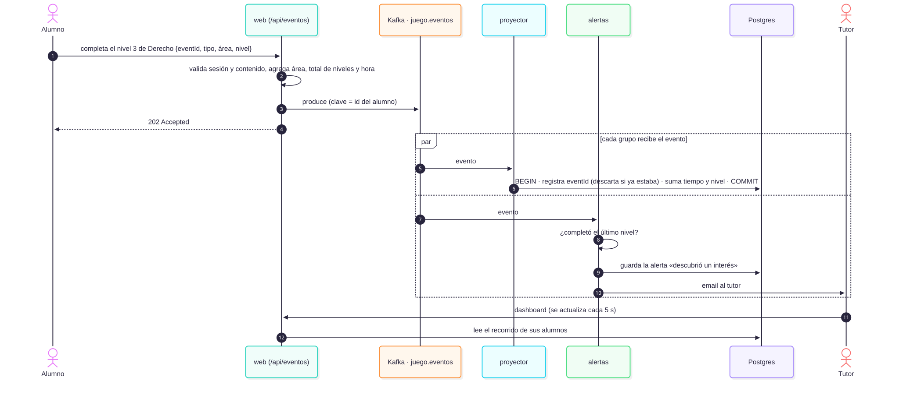

# YOLO · PoC de analíticas del recorrido vocacional con Kafka

Trabajo Práctico Integrador Final de Ingeniería de Software II, segundo cuatrimestre de 2026.

YOLO es una plataforma donde estudiantes de los últimos años de la secundaria exploran carreras jugando. Esta prueba de concepto implementa el **dashboard de analíticas que ven padres y profesores**. Los juegos publican cada interacción en **Apache Kafka**. Dos consumidores independientes las procesan: uno arma el recorrido del alumno y el otro detecta patrones y avisa por email.

- White paper: [`docs/white-paper.md`](docs/white-paper.md). El PDF se genera con `docs/render.sh`.
- Diagramas: [`docs/diagramas/`](docs/diagramas/), con las fuentes en Mermaid.
- Demo en la nube: **<https://yolo-tpif-34cb00.brazilsouth.cloudapp.azure.com>** (credenciales en [Demo en la nube](#demo-en-la-nube)).

## Demo en la nube

La PoC está desplegada en una VM de Azure (región Brazil South): **<https://yolo-tpif-34cb00.brazilsouth.cloudapp.azure.com>**. El despliegue se explica en [Despliegue en Azure](#despliegue-en-azure).

| Para | Cuenta | Contraseña |
|---|---|---|
| Ver el dashboard de un padre, con el historial de Juana y las alertas | `ana+clerk_test@example.com` | `yolo-demo-2026!` |
| Jugar en vivo como alumno | `tomas+clerk_test@example.com` | `yolo-demo-2026!` |
| Ver el dashboard de un profesor | `pablo+clerk_test@example.com` | `yolo-demo-2026!` |

Si Clerk pide un código de verificación, es `424242`. El resto de las cuentas está en [Usuarios de prueba](#usuarios-de-prueba).

- Sin sesión se ve la portada pública. «Ya tengo cuenta» lleva al login y «Crear cuenta», al registro con elección de rol.
- Para ver el flujo completo, conviene abrir a Ana en una ventana y a Tomás en otra privada: lo que juega Tomás aparece en el dashboard de Ana en segundos, con las alertas (pruebas 2 y 3 de [Qué probar](#qué-probar-y-qué-se-espera)).
- Kafka UI y Mailpit no se exponen a Internet. Se ven por túnel SSH, con una clave autorizada en la VM (ver [Despliegue en Azure](#despliegue-en-azure)).

## Historia de usuario

> **Como** padre o profesor, **quiero** ver cuánto tiempo dedica el alumno a cada área, hasta qué nivel llegó y enterarme cuando descubre un interés o se frustra, **para** acompañarlo en su orientación vocacional.

Criterios de aceptación:

1. El dashboard muestra, por área, el **tiempo efectivo** de juego, sin contar las pausas de más de 2 minutos dentro de un nivel. También muestra los niveles completados, el porcentaje de aciertos, los abandonos y la actividad de los últimos 14 días.
2. Lo que el alumno juega aparece en el dashboard en segundos, sin recargar a mano.
3. Si el alumno completa dos niveles distintos de un área, el padre o el profesor recibe un aviso de **interés**. No importa cuánto tiempo pase entre uno y otro.
4. Si sale dos veces del mismo nivel, y en cada salida había hecho al menos un intento, recibe un aviso de **frustración**. Salir sin haber intentado no cuenta. Completar el nivel corta esa racha.
5. Un padre ve solo a los hijos cuyo código vinculó. Un profesor ve solo a los alumnos de su curso.
6. Si el navegador reenvía un evento, o si un consumidor se cae y reprocesa, nada se cuenta dos veces.
7. Si se caen el procesamiento o las alertas, los alumnos pueden seguir jugando, y al volver se procesa todo lo pendiente.

## Arquitectura



| Servicio | Qué hace |
|---|---|
| `web` | App Next.js (TypeScript). Clerk autentica. Hay una portada pública, tres juegos, el dashboard y `POST /api/eventos`, que valida la jugada y **produce** en Kafka. |
| `kafka` | Kafka 4.3 en modo KRaft, sin ZooKeeper. El tópico `juego.eventos` tiene 3 particiones, la clave es el id del alumno y la retención es infinita. |
| `proyector` | Consumidor del grupo `dashboard-proyector`. Calcula el tiempo efectivo, las sesiones y la profundidad, y escribe el modelo de lectura en Postgres. Cada evento se aplica en una transacción junto con su `eventId`, así que es idempotente. |
| `alertas` | Consumidor del grupo `alertas-tutor`. Recibe **los mismos** eventos que el proyector (publish–subscribe), detecta interés y frustración, guarda la alerta y manda el email. El nombre del grupo es histórico: el mail va al padre o al profesor. |
| `postgres` | Roles, vínculos y modelo de lectura. La sesión no se guarda acá: la maneja Clerk. |
| `mailpit` | Servidor SMTP de prueba con bandeja web. |
| `kafka-ui` | Para mirar el tópico, las particiones, los mensajes y el atraso (lag) de cada grupo durante la demo. |
| `seed` | Al arrancar, publica en Kafka diez días de historial de Juana. Corre una sola vez. |

Los tres juegos, uno por carrera, no dependen de reflejos:

| Área | Juego | Cómo se completa un nivel |
|---|---|---|
| Medicina | El caso | Adivinar el diagnóstico tocándolo en la lista. Cada intento muestra cuatro fichas (parte del cuerpo, gravedad, edad típica y dónde se atiende) en verde, amarillo o gris según se parezcan al correcto. Tiene nueve niveles y cada uno trae su propia lista, de 6 a 39 diagnósticos: el 4 suma partes del cuerpo nuevas, en el 5 todos son digestivos, el 6 junta pares casi gemelos, en el 7 todos son de chicos, en el 8 todos son de guardia y el 9 usa el catálogo completo. |
| Sistemas | La bajada | Juntar respuestas de un banco grande: de 3 en el nivel 1 a 6 en los niveles 8 y 9. Desde el nivel 3 hace falta al menos una que no sea obvia (común o rara); el 7 y el 8 piden dos, y el 9, tres. Las raras suman, pero ningún nivel las exige. La comparación ignora tildes, artículos y plurales, tolera un error de tipeo y acepta frases que contienen una respuesta. Una respuesta fuera del banco no se publica ni cuenta como fallo. |
| Derecho | El tablero | Llevar cada situación a su estante: se arrastra, o se toca la ficha y después el estante, también con teclado. Una asignación incorrecta es un fallo y se puede reacomodar. Tiene nueve niveles: el 4 duplica las situaciones, en el 5 todas tienen una palabra que lleva al estante equivocado, el 6 suma los estantes Consumo y Estado, el 7 suma Derechos de autor y Ambiente, el 8 trae diez situaciones y en el 9 cada una toca dos ramas. |

`nivel_completado` lo publica el servidor solo cuando se cumple esa condición. El cliente no puede inventarlo.

Recorrido de un evento:



## Cómo levantarlo

Requisitos: Docker con Compose v2, y [Bun](https://bun.sh) para crear las cuentas de Clerk.

La app no autentica sin las claves de Clerk. Copiá `.env.example` a `.env` y completá `NEXT_PUBLIC_CLERK_PUBLISHABLE_KEY` y `CLERK_SECRET_KEY`. Después:

```bash
bun scripts/clerk.mjs          # crea las cinco cuentas de demo, con rol y contraseña yolo-demo-2026!
docker compose up -d --build
```

La primera vez tarda unos minutos, por el build de Next.js y la descarga de imágenes. Cuando `docker compose ps` muestra todo `running` (y `kafka-init` y `seed` como `exited (0)`), queda disponible:

| URL | Qué es |
|---|---|
| http://localhost:3000 | YOLO: los juegos y el dashboard |
| http://localhost:8025 | Mailpit: los emails |
| http://localhost:8080 | Kafka UI: el tópico `juego.eventos` y los dos grupos de consumidores |

Para volver al estado inicial, borrando todos los datos:

```bash
docker compose down -v && docker compose up -d
```

Las cuentas de Clerk no se borran con ese comando. `bun scripts/clerk.mjs` se puede correr de nuevo: actualiza las que ya existen.

El historial de Juana se fecha respecto del día en que corre el `seed`, y la actividad del dashboard muestra los últimos 14 días. Conviene volver al estado inicial el mismo día de la demo, también en la VM.

## Usuarios de prueba

Todos usan la contraseña `yolo-demo-2026!`. El rol ya está cargado: no pasan por el onboarding. Una cuenta nueva, en cambio, elige alumno, padre o profesor, y vincula por código. Los mails llevan `+clerk_test` porque Clerk rechaza el dominio `.test`. Si pide un código de verificación, es `424242`.

| Email | Rol | Código | Para qué sirve |
|---|---|---|---|
| `juana+clerk_test@example.com` | alumna | `JUANA` | Ya tiene diez días de historial (lo carga el `seed`). |
| `tomas+clerk_test@example.com` | alumno | `TOMAS` | Arranca vacío: es el que se juega en vivo en la demo. |
| `lucia+clerk_test@example.com` | alumna | `LUCIA` | Única alumna del curso `5TOB`. |
| `ana+clerk_test@example.com` | padre | — | Padre de Juana y Tomás. |
| `pablo+clerk_test@example.com` | profesor | curso `5TOB` | Ve solo a Lucía: sirve para probar que no puede abrir a Juana. |

## Qué probar y qué se espera

**1. El historial de Juana.** Ingresá como `ana+clerk_test@example.com`. El dashboard de Juana muestra estos valores:

| Dato | Valor esperado |
|---|---|
| Áreas exploradas | 3 de 3 |
| Tiempo efectivo | 6 min 10 s: Medicina 4 min, Sistemas 1 min 30 s, Derecho 40 s |
| Niveles completados | 2 de 27: Medicina 2/9 con 40 % de aciertos, Sistemas 0/9 con 50 % y 1 abandono, Derecho 0/9 con 0 % y 1 abandono |
| Sesiones | 4 |
| Actividad | 4 días con juego en las últimas dos semanas |
| Alertas | «Descubrió un interés» en Medicina. No hay frustración: cada salida fue una sola vez. |

En Mailpit está el email a Ana por ese interés.

**2. Interés en vivo.** En otra ventana (o en una ventana privada), ingresá como `tomas+clerk_test@example.com` y completá dos niveles distintos de un área, aunque sea de corrido. En el dashboard de Ana, pestaña Tomás, el recorrido se actualiza solo cada 5 segundos. Al terminar el segundo nivel aparece la alerta «Descubrió un interés» y llega el email a Mailpit.

**3. Frustración en vivo.** Como Tomás, en un nivel que todavía no completó, hacé un intento y tocá «Salir del nivel». Volvé a entrar, hacé otro intento y salí otra vez. Aparece la alerta «Señal de frustración» y llega el email. Salir sin intentar no suma, y en La bajada solo cuenta una respuesta que entra al banco. Salir de un nivel ya completado tampoco suma: no se registra.

**4. Desacoplamiento y tolerancia a fallas.**

```bash
docker compose stop alertas proyector   # se caen el procesamiento y los avisos
# ...Tomás sigue jugando sin errores; en Kafka UI se ve crecer el lag de los dos grupos...
docker compose start alertas proyector  # retoman desde su último offset y procesan lo pendiente
```

**5. Control de acceso.** Como `pablo+clerk_test@example.com`, abrí `http://localhost:3000/tutor?alumno=11111111-1111-4111-8111-111111111111` (Juana). Responde 404.

**6. Reprocesar la historia (replay).** Se borra el modelo de lectura y se reconstruye releyendo Kafka desde el offset 0.

```bash
docker compose stop proyector
docker compose exec postgres psql -U yolo -c "truncate eventos_procesados, recorrido_estado, progreso_area, actividad_diaria"
docker compose exec kafka /opt/kafka/bin/kafka-consumer-groups.sh --bootstrap-server localhost:9092 \
  --group dashboard-proyector --topic juego.eventos --reset-offsets --to-earliest --execute
docker compose start proyector   # en segundos, el dashboard vuelve a mostrar exactamente lo mismo
```

Para reprocesar también las alertas, hay que truncar `alertas_procesadas`, `alerta_estado` y `alertas`, y resetear el grupo `alertas-tutor` de la misma manera.

## Endpoint y eventos

`POST /api/eventos` requiere la sesión de Clerk de un **alumno**. En el navegador va por cookie. En las pruebas, por `Authorization: Bearer` con un token de `bun scripts/clerk.mjs token <email>`.

```json
{ "eventId": "<uuid v4>", "tipo": "intento", "area": "medicina", "nivel": 1, "respuesta": "Resfrío" }
```

- `tipo` puede ser `nivel_iniciado`, `intento` o `nivel_abandonado`. El cliente no puede mandar `nivel_completado`: lo publica el servidor cuando el juego se cumple, con id `<eventId>:ok`.
- En El caso y La bajada, `intento` lleva `respuesta`. En El tablero, `situacion` y `estante`.
- Respuestas: **202** si se publicó algo, **200** si el pedido no genera evento, **400** si es inválido, **401** si no hay una sesión de alumno y **403** si el nivel todavía está bloqueado. No generan evento un diagnóstico que no está en la lista del nivel, una respuesta de La bajada que no está en el banco o que ya se dijo, una situación que ya estaba en su estante y la salida de un nivel completado.
- El alumno sale de la sesión, nunca del cuerpo del pedido. El texto escrito no viaja a Kafka.

El evento que se publica (tópico `juego.eventos`, clave = id del alumno):

```json
{ "eventId": "…", "alumnoId": "22222222-…", "tipo": "intento", "area": "medicina", "areaNombre": "Medicina",
  "nivel": 1, "totalNiveles": 9, "acierto": false, "cerca": true, "ts": 1794061721637 }
```

`cerca` aparece en El caso. `rareza` (`obvia`, `comun` o `rara`) aparece en La bajada cuando la respuesta entra al banco.

## Pruebas automáticas

```bash
cd workers && bun test src/reglas.test.ts   # tiempo efectivo, sesiones, interés y frustración
scripts/e2e.sh                              # de punta a punta contra el stack levantado
scripts/carga.sh 1000                       # 1000 eventos en paralelo; mide el atraso del proyector
```

`e2e.sh` y `carga.sh` necesitan `CLERK_SECRET_KEY` y agregan datos a Tomás. Después, conviene volver al estado inicial (ver arriba).

## Atributos de calidad que muestra la PoC

Los escenarios vienen del árbol de utilidad de YOLO (clase 9, Actividad 2).

| Escenario | Cómo lo resuelve la PoC | Cómo verlo |
|---|---|---|
| C1: no perder interacciones si se cae un servicio | Kafka guarda el log y los consumidores retoman desde su offset. El proyector aplica cada evento una sola vez, en una transacción. | Prueba 4 |
| C2: un reenvío no duplica tiempo | `eventId` del navegador, guardado en `eventos_salida`, más `eventos_procesados` en el proyector. | `e2e.sh` |
| R1: el avance se ve en menos de 2 s | El proyector consume en línea. | `carga.sh` |
| S1: cada adulto ve solo a sus alumnos | El padre filtra por `vinculo_padre`. El profesor, por el curso. Si no hay vínculo, el dashboard responde 404. | Prueba 5 |
| S2: ningún dato personal circula por el canal | Los eventos llevan solo el id seudónimo. Nombre y email se buscan recién al mandar el email. El texto del intento no se publica. | Kafka UI, mensajes |
| D2: si fallan las alertas, la exploración sigue | Cada consumidor es un grupo independiente: el productor no los conoce. | Prueba 4 |
| M1: una métrica nueva sin tocar lo existente | Basta con un grupo de consumidores nuevo: con retención infinita, reprocesa toda la historia desde el offset 0. | Prueba 6 |

## Despliegue en Azure

El despliegue en la nube usa el mismo `docker-compose.yml` en una VM. Se le suma [`deploy/docker-compose.cloud.yml`](deploy/docker-compose.cloud.yml), que agrega HTTPS con Caddy (certificado de Let's Encrypt) y deja expuestos solo los puertos 22, 80 y 443.



El `.env` local tiene que tener las claves de Clerk. `deploy/azure.sh` las copia a la VM sin imprimirlas. La contraseña de Postgres se genera allá y no sale de la VM.

```bash
az login                 # cuenta de Azure for Students
deploy/azure.sh          # crea el grupo de recursos y la VM, copia el proyecto y lo levanta
```

El script es idempotente: si la VM ya existe, solo copia los cambios y vuelve a levantar. **Antes de correrlo, hacé `git pull`:** copia el directorio local con `rsync --delete`, así que una copia vieja pisa lo que haya en la VM. Se puede cambiar la región con `LOCATION=brazilsouth deploy/azure.sh`; Azure for Students permite solo algunas regiones. Imprime la URL pública (`https://<nombre>.<región>.cloudapp.azure.com`); la del grupo es <https://yolo-tpif-34cb00.brazilsouth.cloudapp.azure.com>. Las credenciales de acceso son las de [usuarios de prueba](#usuarios-de-prueba). En la VM también hay que haber corrido `bun scripts/clerk.mjs` una vez, desde una máquina con `CLERK_SECRET_KEY`, porque Clerk no vive en el compose.

Kafka UI y Mailpit no se exponen a Internet. Para verlos en la demo:

```bash
ssh -L 8080:localhost:8080 -L 8025:localhost:8025 azureuser@<host>
```

Para cuidar el crédito: `az vm deallocate -g yolo-tpif -n yolo-vm` (se vuelve a prender con `az vm start`). Para borrar todo: `az group delete -n yolo-tpif`.

## Estructura

```
docker-compose.yml        stack completo
db/init.sql               esquema, usuarios de demo, códigos y vínculos
web/                      Next.js: Clerk, portada, tres juegos, dashboard (app/tutor), ingesta
workers/src/              proyector.ts, alertas.ts, seed.ts; la lógica pura está en reglas.ts
scripts/                  clerk.mjs, e2e.sh, carga.sh
deploy/                   azure.sh, cloud-init.yaml, docker-compose.cloud.yml
docs/                     white paper y diagramas
```

## Límites conocidos de la PoC

- **Un solo broker de Kafka**, sin replicación. En producción harían falta 3 brokers o un servicio gestionado, por ejemplo Azure Event Hubs con su endpoint compatible con Kafka.
- **Clerk no está en el compose.** Sin las claves, y sin haber creado las cuentas, no se puede entrar. Es un servicio externo a propósito: la identidad no es lo que la PoC demuestra.
- **El email se manda después de guardar la alerta.** Si el envío falla, la alerta queda en el dashboard pero sin email. Con un outbox se resolvería.
- **El contenido es de ejemplo.** Lo que se evalúa es la arquitectura, no los diagnósticos ni las consignas.
