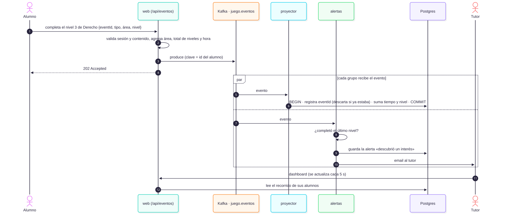

# YOLO · PoC de analíticas del recorrido vocacional con Kafka

Trabajo Práctico Integrador Final de Ingeniería de Software II, segundo cuatrimestre de 2026.

YOLO es una plataforma donde estudiantes de los últimos años de la secundaria exploran carreras jugando. Esta prueba de concepto implementa su funcionalidad principal: el **dashboard de analíticas que ven padres y tutores**. Los juegos publican cada interacción en **Apache Kafka**. Dos consumidores independientes las procesan: uno arma el recorrido del alumno y el otro detecta patrones y avisa al tutor por email.

- White paper: [`docs/white-paper.md`](docs/white-paper.md). El PDF se genera con `docs/render.sh`.
- Diagramas: [`docs/diagramas/`](docs/diagramas/), con las fuentes en Mermaid.

## Historia de usuario

> **Como** tutor de un alumno, **quiero** ver cuánto tiempo dedica a cada área, hasta qué nivel llegó y enterarme cuando descubre un interés o se frustra, **para** acompañarlo en su orientación vocacional.

Criterios de aceptación:

1. El dashboard muestra, por área, el **tiempo efectivo** de juego, sin contar las pausas de más de 2 minutos dentro de un nivel. También muestra los niveles completados, el porcentaje de aciertos, los abandonos y la actividad de los últimos 14 días.
2. Lo que el alumno juega aparece en el dashboard en segundos, sin recargar a mano.
3. Si el alumno completa todos los niveles de un área, el tutor recibe un aviso de **interés**.
4. Si abandona 3 niveles seguidos en menos de un minuto, el tutor recibe un aviso de **frustración**.
5. Un tutor ve **solo** a sus alumnos vinculados.
6. Si el navegador reenvía un evento, o si un consumidor se cae y reprocesa, nada se cuenta dos veces.
7. Si se caen el procesamiento o las alertas, los alumnos pueden seguir jugando, y al volver se procesa todo lo pendiente.

## Arquitectura



| Servicio | Qué hace |
|---|---|
| `web` | App Next.js (TypeScript): login, los juegos, el dashboard del tutor y `POST /api/eventos`, que valida, enriquece y **produce** en Kafka. |
| `kafka` | Kafka 4.3 en modo KRaft, sin ZooKeeper. El tópico `juego.eventos` tiene 3 particiones, la clave es el id del alumno y la retención es infinita. |
| `proyector` | Consumidor del grupo `dashboard-proyector`. Calcula el tiempo efectivo, las sesiones y la profundidad, y escribe el modelo de lectura en Postgres. Cada evento se aplica en una transacción junto con su `eventId`, así que es idempotente. |
| `alertas` | Consumidor del grupo `alertas-tutor`. Recibe **los mismos** eventos que el proyector (publish–subscribe), detecta interés y frustración, guarda la alerta y manda el email. |
| `postgres` | Usuarios, sesiones y modelo de lectura. |
| `mailpit` | Servidor SMTP de prueba con bandeja web: ahí llegan los emails a los tutores. |
| `kafka-ui` | Para mirar el tópico, las particiones, los mensajes y el atraso (lag) de cada grupo durante la demo. |
| `seed` | Al arrancar, publica en Kafka dos semanas de historial de Juana. Corre una sola vez. |

Recorrido de un evento:



## Cómo levantarlo

Requisito: Docker con Compose v2.

```bash
docker compose up -d --build
```

La primera vez tarda unos minutos, por el build de Next.js y la descarga de imágenes. Cuando `docker compose ps` muestra todo `running` (y `kafka-init` y `seed` como `exited (0)`), queda disponible:

| URL | Qué es |
|---|---|
| http://localhost:3000 | YOLO: los juegos y el dashboard |
| http://localhost:8025 | Mailpit: los emails que reciben los tutores |
| http://localhost:8080 | Kafka UI: el tópico `juego.eventos` y los dos grupos de consumidores |

Para volver al estado inicial, borrando todos los datos:

```bash
docker compose down -v && docker compose up -d
```

## Usuarios de prueba

Todos usan la contraseña `yolo1234`.

| Email | Rol | Para qué sirve |
|---|---|---|
| `juana@yolo.test` | alumna | Ya tiene dos semanas de historial (lo carga el `seed`). |
| `tomas@yolo.test` | alumno | Arranca vacío: es el que se juega en vivo en la demo. |
| `lucia@yolo.test` | alumna | Alumna de otro tutor. |
| `ana@yolo.test` | tutora | Tutora de Juana y Tomás. |
| `pablo@yolo.test` | tutor | Tutor solo de Lucía: sirve para probar que no puede ver a Juana. |

## Qué probar y qué se espera

**1. El historial de Juana.** Ingresá como `ana@yolo.test`. El dashboard de Juana muestra estos valores:

| Dato | Valor esperado |
|---|---|
| Áreas exploradas | 3 de 3 |
| Tiempo efectivo | 10 min 40 s: Medicina 5 min, Sistemas 4 min 30 s, Derecho 1 min 10 s |
| Niveles completados | 5 de 9: Medicina 3/3 con 83 % de aciertos, Sistemas 2/3 con 100 % y 1 abandono, Derecho 0/3 con 1 abandono |
| Sesiones | 6 |
| Actividad | 6 días con juego en las últimas dos semanas |
| Alertas | «Descubrió un interés» en Medicina |

En Mailpit está el email a Ana por ese interés.

**2. Interés en vivo.** En otra ventana (o en una ventana privada), ingresá como `tomas@yolo.test` y completá los 3 niveles de un área. En el dashboard de Ana, pestaña Tomás, el recorrido se actualiza solo cada 5 segundos. Al terminar el nivel 3 aparece la alerta «Descubrió un interés» y llega el email a Mailpit.

**3. Frustración en vivo.** Como Tomás, entrá a un nivel y tocá «Salir del nivel», tres veces en menos de un minuto. Aparece la alerta «Señal de frustración» y llega el email.

**4. Desacoplamiento y tolerancia a fallas.**

```bash
docker compose stop alertas proyector   # se caen el procesamiento y los avisos
# ...Tomás sigue jugando sin errores; en Kafka UI se ve crecer el lag de los dos grupos...
docker compose start alertas proyector  # retoman desde su último offset y procesan lo pendiente
```

**5. Control de acceso.** Como `pablo@yolo.test`, abrí `http://localhost:3000/tutor?alumno=11111111-1111-4111-8111-111111111111` (Juana). Responde 404.

**6. Reprocesar la historia (replay).** Se borra el modelo de lectura y se reconstruye releyendo Kafka desde el offset 0. Es lo mismo que haría un consumidor nuevo para calcular una métrica nueva sobre toda la historia, o el proyector después de corregir un error de cálculo.

```bash
docker compose stop proyector
docker compose exec postgres psql -U yolo -c "truncate eventos_procesados, recorrido_estado, progreso_area, actividad_diaria"
docker compose exec kafka /opt/kafka/bin/kafka-consumer-groups.sh --bootstrap-server localhost:9092 \
  --group dashboard-proyector --topic juego.eventos --reset-offsets --to-earliest --execute
docker compose start proyector   # en segundos, el dashboard vuelve a mostrar exactamente lo mismo
```

## Endpoint y eventos

`POST /api/eventos` requiere la cookie de sesión de un **alumno**.

```json
{ "eventId": "<uuid v4>", "tipo": "decision", "area": "medicina", "nivel": 1, "situacion": 0, "opcion": 1 }
```

- `tipo` puede ser `nivel_iniciado`, `decision`, `nivel_completado` o `nivel_abandonado`. `situacion` y `opcion` van solo en `decision`.
- Respuestas: **202** si el evento quedó publicado, **400** si es inválido (área, nivel u opción inexistentes, o `eventId` que no es UUID) y **401** si no hay una sesión de alumno.
- El alumno sale de la sesión, nunca del cuerpo del pedido. Si la respuesta es correcta lo calcula el servidor.

El evento que se publica en Kafka (tópico `juego.eventos`, clave = id del alumno) no lleva datos personales:

```json
{ "eventId": "…", "alumnoId": "22222222-…", "tipo": "decision", "area": "medicina", "areaNombre": "Medicina",
  "nivel": 1, "totalNiveles": 3, "correcta": true, "ts": 1794061721637 }
```

## Pruebas automáticas

```bash
cd workers && npm ci && npm test     # reglas de tiempo efectivo, sesiones, interés y frustración (node:test)
scripts/e2e.sh                       # de punta a punta contra el stack levantado: 16 verificaciones
scripts/carga.sh 1000                # 1000 eventos en paralelo; mide el atraso del proyector
```

`e2e.sh` y `carga.sh` agregan datos a Tomás. Después, conviene volver al estado inicial (ver arriba).

Resultado de referencia de `carga.sh 1000` en una notebook: los 1000 eventos se aceptaron (202) y el proyector terminó de procesarlos 0,4 s después del último. El cuello de botella fue el script, que lanza un proceso `curl` por evento.

## Atributos de calidad que muestra la PoC

Los escenarios vienen del árbol de utilidad de YOLO (clase 9, Actividad 2).

| Escenario | Cómo lo resuelve la PoC | Cómo verlo |
|---|---|---|
| C1: no perder interacciones si se cae un servicio | Kafka guarda el log y los consumidores retoman desde su offset. El proyector aplica cada evento una sola vez, en una transacción. | Prueba 4 |
| C2: un reenvío no duplica tiempo | `eventId` generado en el navegador, que se repite en cada reintento, más la tabla `eventos_procesados`. | `e2e.sh` |
| R1: el avance se ve en menos de 2 s | El proyector consume en línea. El atraso medido fue de menos de medio segundo con 1000 eventos. | `carga.sh` |
| S1: cada tutor ve solo a sus alumnos | El dashboard filtra por la tabla `tutor_alumno` y responde 404 si no hay vínculo. | Prueba 5 |
| S2: ningún dato personal circula por el canal | Los eventos llevan solo el id seudónimo. Nombre y email se buscan recién al mandar el email. | Kafka UI, mensajes |
| D2: si fallan las alertas, la exploración sigue | Cada consumidor es un grupo independiente: el productor no los conoce. | Prueba 4 |
| M1: una métrica nueva sin tocar lo existente | Basta con un grupo de consumidores nuevo: con retención infinita, reprocesa toda la historia desde el offset 0. | Prueba 6: con 1062 mensajes, el reproceso dio un resultado idéntico en menos de 20 s |

## Despliegue en Azure

El despliegue en la nube usa el mismo `docker-compose.yml` en una VM. Se le suma [`deploy/docker-compose.cloud.yml`](deploy/docker-compose.cloud.yml), que agrega HTTPS con Caddy (certificado de Let's Encrypt) y deja expuestos solo los puertos 22, 80 y 443.



```bash
az login                 # cuenta de Azure for Students
deploy/azure.sh          # crea el grupo de recursos y la VM, copia el proyecto y lo levanta
```

El script es idempotente: si la VM ya existe, solo copia los cambios y vuelve a levantar. Se puede cambiar la región con `LOCATION=brazilsouth deploy/azure.sh`; Azure for Students permite solo algunas regiones. Imprime la URL pública (`https://<nombre>.<región>.cloudapp.azure.com`). Las credenciales de acceso son las de [usuarios de prueba](#usuarios-de-prueba).

Kafka UI y Mailpit no se exponen a Internet. Para verlos en la demo:

```bash
ssh -L 8080:localhost:8080 -L 8025:localhost:8025 azureuser@<host>
```

Para cuidar el crédito: `az vm deallocate -g yolo-tpif -n yolo-vm` (se vuelve a prender con `az vm start`). Para borrar todo: `az group delete -n yolo-tpif`.

## Estructura

```
docker-compose.yml        stack completo
db/init.sql               esquema, usuarios de prueba y vínculos tutor-alumno
web/                      Next.js: juegos (lib/contenido.ts), dashboard (app/tutor), ingesta (app/api/eventos)
workers/src/              proyector.ts, alertas.ts, seed.ts; la lógica pura está en reglas.ts (con tests)
scripts/                  e2e.sh, carga.sh
deploy/                   azure.sh, cloud-init.yaml, docker-compose.cloud.yml
docs/                     white paper y diagramas
```

## Límites conocidos de la PoC

- **Un solo broker de Kafka**, sin replicación. En producción harían falta 3 brokers o un servicio gestionado, por ejemplo Azure Event Hubs con su endpoint compatible con Kafka.
- **La racha de abandonos vive en memoria** del consumidor de alertas: si se reinicia en medio de una racha, esa racha se pierde.
- **El email se manda después de guardar la alerta.** Si el envío falla, la alerta queda en el dashboard pero sin email. Con un outbox se resolvería.
- **El servidor no controla el desbloqueo de niveles**, solo la interfaz. Lo peor que puede pasar es que el alumno altere sus propias métricas.
- **Los juegos son de decisiones**, con contenido de ejemplo: lo que se evalúa es la arquitectura, no el contenido.
