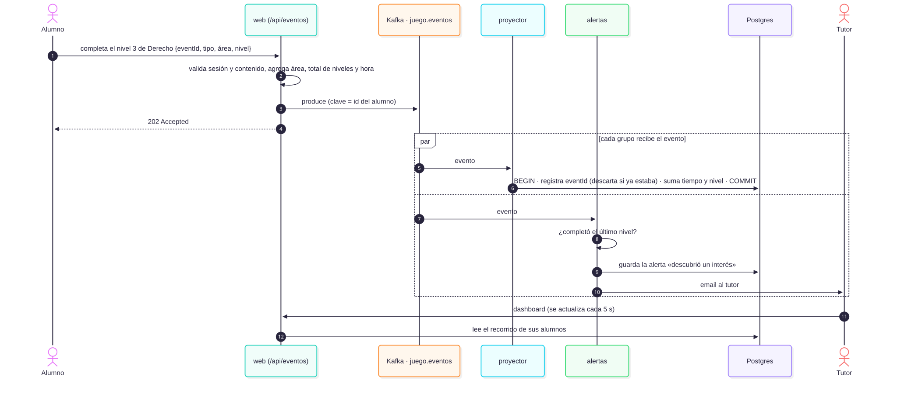

<strong>Ingeniería de Software II</strong>

Trabajo Práctico Integrador Final · White paper

Instituto Tecnológico de Buenos Aires

YOLO: descubrí tu camino

**Integrantes:**

- Branda, Franco (65506)
- Costa, Francisco (65202)
- Garbarz, Andrés (65488)
- Migliaro, Eugenio (65508)

**Repositorio:** <https://github.com/eugemigliaro/inge2-yolo>

2.º cuatrimestre de 2026

## Contenido

- [1. El problema](#problema)
- [2. La solución: YOLO](#solucion)
- [3. Eje funcional: streaming de eventos al servicio del recorrido](#eje-funcional)
    - [3.1 El concepto](#concepto)
    - [3.2 Utilidad para YOLO, con ejemplos](#utilidad)
    - [3.3 Comparativa de alternativas](#comparativa)
    - [3.4 Cómo las decisiones técnicas sirven al negocio](#negocio)
- [4. Eje técnico: Apache Kafka](#eje-tecnico)
    - [4.1 Qué es y cómo funciona](#kafka)
    - [4.2 Arquitectura de la prueba de concepto](#arquitectura)
    - [4.3 Atributos de calidad: escenarios y evidencia](#atributos)
- [5. Qué hace falta para llevarlo adelante](#recursos)
- [6. Riesgos y próximos pasos](#riesgos)
- Anexos: [A. Demo en la nube y stack](#anexo) · [B. Diagramas](#diagramas) · [C. Referencias](#referencias)

## 1. El problema {#problema}

Elegir una carrera al terminar la secundaria es una decisión grande que se toma con poca información. La orientación vocacional tradicional se basa en tests y entrevistas puntuales, y tiene tres límites. Pregunta por actividades que el estudiante nunca probó, así que responde según la imagen que tiene de cada carrera. Mide lo que declara, que puede estar influido por la familia, los amigos o el prestigio de una profesión. Y toma una foto de un día, a una edad en la que los intereses todavía cambian. Los padres y los profesores, que acompañan la decisión, ven a lo sumo el resultado del test, no cómo explora el estudiante.

Lo que falta es poder probar: que el estudiante explore las carreras jugando y que su recorrido quede registrado, es decir, qué áreas exploró, cuánto tiempo les dedicó de verdad y hasta qué profundidad llegó, en una forma que un adulto entienda.

Registrar ese recorrido es técnicamente complejo por cuatro razones:

- **El juego no espera al cálculo.** Cada intento es un evento. El alumno tiene que poder seguir jugando aunque las métricas se calculen un instante después.
- **Métricas derivadas, no datos crudos.** El «tiempo dedicado» no es la diferencia entre entrar y salir: hay que descontar la pestaña abierta y abandonada. Esto exige procesar los eventos de cada alumno en orden y con estado.
- **Métricas que van a cambiar.** Qué conviene medir se va a ir ajustando con el uso real. Una métrica que se agregue en el mes 6 tiene que poder calcularse también sobre los meses 1 a 5.
- **Datos de menores de edad.** Cada padre ve solo a sus hijos y cada profesor, solo a su curso. Los datos personales deben circular lo menos posible.

## 2. La solución: YOLO {#solucion}

YOLO es una plataforma web de juegos por área (Medicina, Sistemas, Derecho…). Cada área tiene niveles que se profundizan progresivamente, y completar uno desbloquea el siguiente. A diferencia de un test, no recomienda una carrera: registra cómo explora el estudiante y convierte ese recorrido en información que un adulto entiende, que es el valor diferencial del producto. Los colegios la incorporan como material y las familias pagan una suscripción mensual.

**Funcionalidades principales:**

1. Tres juegos de texto, uno por carrera: El caso (Medicina), La bajada (Sistemas) y El tablero (Derecho). No dependen de reflejos. El contenido es datos.
2. Registro del recorrido: áreas exploradas, tiempo efectivo, profundidad, aciertos y abandonos.
3. **Dashboard para padres y profesores** con la evolución del alumno *(PoC)*.
4. **Alertas**: descubrió un interés al completar dos niveles de un área; señal de frustración al salir dos veces del mismo nivel después de haber intentado *(PoC)*.
5. Reportes agregados por curso para los colegios.
6. Gestión de contenidos y suscripciones.

La PoC implementa la historia de usuario central del producto:

> **Como** padre o profesor, **quiero** ver cuánto tiempo dedica el alumno a cada área, hasta qué nivel llegó y enterarme cuando descubre un interés o se frustra, **para** acompañarlo en su orientación vocacional.

## 3. Eje funcional: streaming de eventos al servicio del recorrido {#eje-funcional}

### 3.1 El concepto {#concepto}

En una arquitectura de **streaming de eventos**, cada cosa que pasa se registra como un *evento*: un hecho inmutable, como «Tomás completó el nivel 2 de Medicina a las 11:29». Los eventos se publican en un log ordenado y durable. Los interesados se **suscriben** a ese log por su cuenta, sin que el productor los conozca: es el estilo *publish–subscribe*.

Sobre el mismo flujo, la PoC usa los tres tipos de procesamiento de eventos vistos en la materia:

| Tipo | En YOLO |
|--------------|----------------------------------|
| *Single event processing* | Un nivel completado actualiza la profundidad. Solo no alcanza para avisar. |
| *Event stream processing* | Tiempo efectivo, sesiones y profundidad, agregados en línea por alumno. |
| *Complex event processing* | Dos niveles distintos de un área → interés. Dos salidas del mismo nivel, con intentos antes de cada una → frustración. |

### 3.2 Utilidad para YOLO, con ejemplos {#utilidad}

- **Un hecho, varios interesados.** `nivel_completado` le sirve al dashboard, a las alertas y, más adelante, a los reportes del colegio y a las métricas de negocio. Cada uno es un consumidor nuevo; el juego no cambia.
- **El juego no depende del mail.** El juego publica y recibe la respuesta enseguida (HTTP 202). Si el servidor de mail o el procesamiento se caen, los eventos esperan en el log, los alumnos siguen jugando y, al volver, cada consumidor se pone al día.
- **Una métrica nueva sobre toda la historia.** Si el piloto pide «áreas que el alumno revisitó», se suma un consumidor que lee el log desde el principio y calcula la métrica para todos los alumnos, sin migrar datos ni tocar lo que ya funciona.
- **Corregir un error de cálculo.** Si una regla del tiempo efectivo estaba mal, se corrige el consumidor y se reprocesa la historia. El modelo de lectura se reconstruye desde los hechos originales.

### 3.3 Comparativa de alternativas {#comparativa}

La alternativa seria no es otro broker, sino no usar ninguno: que el juego escriba directo en Postgres.

| Criterio | Escritura directa en Postgres | **Kafka** | RabbitMQ | Batch nocturno (Airflow / Prefect) |
|---|---|---|---|---|
| Alcanza para el volumen del piloto | Sí, de sobra | Sí, sobredimensionado | Sí | Sí |
| Calcular una métrica nueva sobre la historia | Solo si además se guardan los eventos crudos | Sí: el log se retiene y se relee | No en colas clásicas (el mensaje se borra al confirmarlo). Sí con RabbitMQ Streams | Sí, si se guardan los eventos crudos aparte |
| Si se cae el mail… | El pedido del juego lo tiene que manejar | El juego sigue y las alertas se ponen al día | El juego sigue y las alertas se ponen al día | Se reintenta la corrida |
| Varios consumidores independientes | Acoplados al código que escribe | Grupos de consumidores | *Exchanges* con una cola por consumidor | Tareas dentro de un mismo DAG |
| Alertas al padre o al profesor | Al jugar | Al jugar | Al jugar | Al día siguiente |
| Complejidad operativa | Baja | Media-alta | Media | Media |

**Pros y contras.**

- **Escritura directa en Postgres.** A favor: es lo más simple y barato, y a la escala del piloto la base alcanza. En contra: guarda el estado, no los hechos, así que una métrica nueva no se puede calcular hacia atrás sin guardar también un log de eventos; y el juego queda acoplado a cada métrica y al envío del mail.
- **Kafka.** A favor: el log se retiene y se relee, varios consumidores leen lo mismo sin conocerse y el orden por alumno sale de la clave. En contra: es más pesado de operar y, por volumen, el piloto no lo necesita.
- **RabbitMQ.** A favor: es más simple y muy bueno para repartir tareas. En contra: su modelo de colas borra el mensaje al consumirlo, y el replay, que es justo lo que pide la evolución de las métricas, no es su caso de uso natural.
- **Batch con Airflow o Prefect.** A favor: es la herramienta adecuada para el reporte nocturno por colegio. En contra: las alertas llegarían al día siguiente. Es una opción *complementaria*, no una alternativa.

**Decisión: Kafka.** No lo elegimos por volumen ni por tiempo real: para eso, Postgres alcanza. Lo elegimos por dos razones: poder recalcular sobre toda la historia métricas que todavía no existen, y que el juego siga aunque el mail se caiga. En producción conviene usarlo como servicio gestionado, como Confluent Cloud o Azure Event Hubs con su endpoint compatible con Kafka, para no operar los brokers.

### 3.4 Cómo las decisiones técnicas sirven al negocio {#negocio}

| Necesidad del negocio | Decisión técnica | Beneficio |
|---|---|---|
| Darles a las familias información sobre la exploración: el valor diferencial | Procesamiento en stream con estado por alumno | Un «tiempo dedicado» creíble, que no se infla con pestañas abandonadas |
| Riesgo de baja percepción de valor | Alertas como consumidor independiente | El padre o el profesor recibe valor sin tener que entrar al dashboard |
| Riesgo de contenido poco atractivo | Detectar patrones de frustración (CEP) | Señal temprana de qué niveles no enganchan, para el equipo de contenidos |
| Ajustar las métricas después del piloto | Retención infinita y relectura del log | Métricas nuevas sobre toda la historia, sin migraciones |
| Expandir a más colegios | Particiones y grupos de consumidores | Escalar agregando instancias, sin rediseñar |
| Costos de infraestructura acotados | Una VM con Docker Compose para el piloto | Unos USD 30 por mes; los servicios gestionados recién en la expansión |
| Usuarios menores de edad | Eventos con un id seudónimo y control de acceso por vínculo | Menos exposición si se filtra un evento; cada padre ve a sus hijos y cada profesor, a su curso |

## 4. Eje técnico: Apache Kafka {#eje-tecnico}

### 4.1 Qué es y cómo funciona {#kafka}

Apache Kafka es una plataforma distribuida de *event streaming*. Nació en LinkedIn y hoy es un proyecto de la Apache Software Foundation. Su abstracción central es un **log de solo escritura al final** (*append-only*), durable y particionado:

- **Tópicos y particiones.** Un tópico (`juego.eventos`) se divide en particiones. Cada partición es una secuencia ordenada de mensajes, y cada mensaje tiene una posición: el *offset*. El productor elige la partición a partir de la **clave** del mensaje. En YOLO la clave es el id del alumno, así que todos los eventos de un alumno quedan en orden en la misma partición, que es lo que necesita el cálculo del tiempo efectivo.
- **Retención.** Leer un mensaje no lo borra. Los mensajes se conservan por tiempo, por tamaño o para siempre, o se compactan por clave. Esto permite que un consumidor nuevo, o uno corregido, relea la historia.
- **Productores.** Con `acks=all` y el **productor idempotente**, cada mensaje lleva un id de productor y un número de secuencia: los reintentos internos del cliente no duplican mensajes en el log.
- **Consumidores y grupos.** Cada grupo de consumidores recibe *todos* los mensajes del tópico (publish–subscribe entre grupos). Dentro de un grupo, cada partición se asigna a un solo consumidor, así que el paralelismo llega hasta la cantidad de particiones. Cada grupo guarda su avance (los *offsets* confirmados) en el propio Kafka: si un consumidor se cae, retoma desde ahí.
- **Garantías de entrega.** Kafka ofrece transacciones para la entrega *exactly-once* entre tópicos. Cuando el efecto ocurre fuera de Kafka, en este caso en Postgres, el patrón habitual es *at-least-once* con un **consumidor idempotente**. Es lo que hace la PoC: cada evento se aplica en la misma transacción en la que se registra su `eventId`.
- **KRaft.** Desde Kafka 4.0, los metadatos del clúster se gestionan con un protocolo de consenso propio basado en Raft, y ZooKeeper ya no existe. Por eso la PoC corre en un solo contenedor que es broker y controlador a la vez.
- **Ecosistema.** Kafka Connect (integración con bases y servicios), Kafka Streams (procesamiento en Java), Schema Registry (contratos de eventos) y servicios gestionados como Confluent Cloud, Amazon MSK y Azure Event Hubs.

### 4.2 Arquitectura de la prueba de concepto {#arquitectura}

1. El alumno juega en la app web (Next.js, TypeScript). Cada interacción se envía a `POST /api/eventos` con un `eventId` generado en el navegador, que se repite si hay que reintentar.
2. La ingesta **valida**: la sesión de Clerk tiene que ser de un alumno, y el área y el nivel tienen que existir. El servidor decide si la jugada es correcta. El texto escrito no se publica. El alumno se toma de la sesión, nunca del cuerpo del pedido. El evento se **publica** en Kafka con la clave = alumno y se responde 202. `nivel_completado` lo emite el servidor, no el cliente.
3. El **proyector** (grupo `dashboard-proyector`) calcula el tiempo efectivo (no cuenta los huecos de más de 2 minutos dentro de un nivel), las sesiones (30 minutos sin actividad cierran una) y la profundidad, y actualiza el modelo de lectura en Postgres.
4. **Alertas** (grupo `alertas-tutor`) recibe los mismos eventos. Avisa interés cuando hay dos niveles distintos completados en un área, y frustración cuando el alumno sale dos veces del mismo nivel después de haber intentado. El estado de esa racha queda en Postgres. Nombre y email se buscan recién al mandar el mail: el evento solo lleva el id seudónimo.
5. El **dashboard** del padre o del profesor lee el modelo de lectura y se actualiza cada 5 segundos.

Todo se levanta con `docker compose up`: Kafka, Postgres, la app web, los dos consumidores, un servidor SMTP de prueba y Kafka UI. El despliegue en la nube usa el mismo compose en una VM de Azure, con HTTPS mediante Caddy.

### 4.3 Atributos de calidad: escenarios y evidencia {#atributos}

Los escenarios vienen del árbol de utilidad de YOLO. La evidencia sale de la PoC, ejecutada en una notebook.

| Escenario | Mecanismo | Evidencia |
|---|---|---|
| **Confiabilidad.** Si se cae el procesamiento, no se pierde ninguna interacción. | Log durable y offsets por grupo | Con los consumidores detenidos, el juego respondió 202. El *lag* de cada grupo llegó a 6, y al reiniciarlos ambos procesaron todo. |
| **Confiabilidad.** Un reenvío no se cuenta dos veces. | `eventId` y tabla de eventos procesados, en la misma transacción | El mismo evento enviado dos veces se contó una vez (prueba automática). |
| **Usabilidad.** El adulto ve el avance sin recargar la página. | Consumo en línea y consulta del dashboard cada 5 s | Lo que juega Tomás aparece en el dashboard de Ana en el siguiente refresco. No hace falta más: el adulto no mira el dashboard segundo a segundo. |
| **Disponibilidad.** Si fallan las alertas, la exploración sigue. | Grupos independientes | Al detener `alertas`, ni el juego ni el dashboard se enteraron. |
| **Seguridad.** Cada adulto ve solo a sus alumnos. | El padre filtra por el vínculo y el profesor, por el curso. | Un profesor que pide a un alumno de otro curso recibe 404. |
| **Modificabilidad.** Una métrica nueva o una corrección no modifican lo existente. | Releer el log desde el offset 0 | Se borra el modelo de lectura y el proyector reconstruye el dashboard desde el offset 0. |

## 5. Qué hace falta para llevarlo adelante {#recursos}

**Tiempo.** Estimamos con PERT, en semanas-persona, el módulo de analíticas listo para el piloto: el paso de la PoC a producción.

| Paquete de trabajo | O | M | P | PERT |
|------------------------------------------------|--|--|--|---|
| Ingesta y contratos de eventos (Schema Registry) | 1 | 2 | 4 | 2,2 |
| Proyector, modelo de lectura y reproceso | 2 | 3 | 6 | 3,3 |
| Dashboard validado con familias | 2 | 4 | 7 | 4,2 |
| Alertas y email transaccional con *outbox* | 1 | 2 | 4 | 2,2 |
| Infraestructura gestionada, monitoreo del *lag* y seguridad | 2 | 3 | 6 | 3,3 |
| Pruebas y puesta en marcha del piloto | 2 | 3 | 5 | 3,2 |
| **Total** | | | | **18,3** |

Con tres personas desarrollando, son unas 6 o 7 semanas de calendario más contingencia. Entra en los meses 1 a 3 del plan del business case, junto con los juegos.

**Recursos humanos.** Una persona de backend y datos (Kafka, consumidores), una de frontend (juegos y dashboard) y una de producto y contenidos (diseño de los juegos, validación con colegios y familias). Hace falta además una dedicación parcial a operación.

**Recursos técnicos.**

- **Piloto:** una VM de 2 vCPU y 4 GB, unos USD 30 por mes a precio de lista, más dominio y un servicio de email transaccional.
- **Expansión:** Kafka gestionado con tres réplicas, Postgres gestionado y más instancias de los consumidores. Son precios de lista aproximados, a revisar al presupuestar.

## 6. Riesgos y próximos pasos {#riesgos}

- **Kafka es mucho para el piloto.** La alternativa de la clase 9 era empezar con un bus interno en la base de datos. Elegimos Kafka desde la PoC porque el replay es justamente lo que pide la evolución de las métricas, porque desacopla el juego del mail y porque en una VM cuesta lo mismo. Si el piloto no crece, Kafka se puede reemplazar sin tocar los juegos, ya que los contratos de eventos no cambian.
- **Operar Kafka con un equipo chico.** Se mitiga con un servicio gestionado en la expansión.
- **Próximos pasos:** reportes por curso para colegios (un consumidor nuevo), *outbox* para los emails y contratos de eventos con Schema Registry.

## Anexo A: demo en la nube y stack {#anexo}

**Demo desplegada.** La PoC corre en una VM de Azure (Brazil South), con el mismo `docker-compose.yml` más Caddy para HTTPS: <https://yolo-tpif-34cb00.brazilsouth.cloudapp.azure.com>. El código y las instrucciones están en <https://github.com/eugemigliaro/inge2-yolo>.

**Credenciales de prueba.** Todas las cuentas usan la misma contraseña, que se envía junto con la entrega y no figura en el repositorio, porque es público. Si Clerk pide un código de verificación, es `424242`.

| Para | Cuenta |
|---|---|
| Dashboard de un padre, con el historial de Juana y las alertas | `ana+clerk_test@example.com` |
| Jugar en vivo como alumno | `tomas+clerk_test@example.com` |
| Dashboard de un profesor (curso 5TOB) | `pablo+clerk_test@example.com` |

Kafka UI y Mailpit no se exponen a Internet; se ven por túnel SSH.

**Stack.**

| Capa | Tecnología |
|---|---|
| App web, juegos e ingesta | Next.js 16, React 19 y TypeScript |
| Identidad | Clerk (email y contraseña; el rol también se guarda en Postgres) |
| Streaming de eventos | Apache Kafka 4.3 en modo KRaft; tópico `juego.eventos` con 3 particiones |
| Consumidores (proyector y alertas) | Node 24 y TypeScript, con el cliente `@confluentinc/kafka-javascript` |
| Modelo de lectura y estado de alertas | PostgreSQL 17 |
| Email y observación | Mailpit (SMTP de prueba) y Kafka UI |
| Despliegue | Docker Compose; en la nube, VM de Azure con Caddy |

## Anexo B: despliegue y secuencia de un evento {#diagramas}

**Vista física.** Una VM de Azure corre el mismo `docker compose` que la PoC local. Solo los puertos 22, 80 y 443 quedan abiertos: Caddy termina HTTPS y Kafka UI y Mailpit escuchan únicamente en `127.0.0.1`.

**Un evento, de punta a punta.** El alumno completa el segundo nivel de Medicina. La ingesta responde 202 en cuanto el evento está en Kafka, y los dos grupos de consumidores lo procesan en paralelo, sin conocerse.

## Anexo C: referencias {#referencias}

**Material de la materia**

- Clase 5: estimación de proyectos de software (PERT). Ingeniería de Software II, ITBA, 2026.
- Clase 8: vistas y estilos de arquitectura (*publish–subscribe*, *pipes & filters* y los tipos de procesamiento de eventos). Ingeniería de Software II, ITBA, 2026.
- Clase 9: evaluación de arquitecturas (atributos de calidad y árbol de utilidad). Ingeniería de Software II, ITBA, 2026.

**Kafka**

- Apache Software Foundation. *Apache Kafka Documentation*: tópicos, particiones, grupos de consumidores, retención y garantías de entrega. <https://kafka.apache.org/documentation/>
- KIP-500: *Replace ZooKeeper with a Self-Managed Metadata Quorum* (origen de KRaft). <https://cwiki.apache.org/confluence/display/KAFKA/KIP-500%3A+Replace+ZooKeeper+with+a+Self-Managed+Metadata+Quorum>
- KIP-98: *Exactly Once Delivery and Transactional Messaging* (productor idempotente y transacciones). <https://cwiki.apache.org/confluence/display/KAFKA/KIP-98+-+Exactly+Once+Delivery+and+Transactional+Messaging>
- Confluent. *confluent-kafka-javascript*, el cliente usado por la ingesta y los consumidores. <https://github.com/confluentinc/confluent-kafka-javascript>

**Alternativas y servicios gestionados**

- RabbitMQ. *Streams*, el modo de RabbitMQ con log retenido y relectura. <https://www.rabbitmq.com/docs/streams>
- Microsoft. *Azure Event Hubs for Apache Kafka*. <https://learn.microsoft.com/en-us/azure/event-hubs/azure-event-hubs-apache-kafka-overview>
