# 1. El problema

Elegir una carrera al terminar la secundaria es una decisión grande que se toma con poca información. La orientación vocacional tradicional se basa en tests y entrevistas puntuales. Dicen *qué podría gustarle* a un estudiante, pero no muestran *qué hace* cuando tiene la oportunidad de explorar. Los padres y tutores, que acompañan la decisión, casi nunca ven ese proceso.

YOLO propone que el estudiante explore carreras jugando y que el recorrido quede registrado: qué áreas exploró, cuánto tiempo les dedicó de verdad y hasta qué profundidad llegó. Esa información, convertida en algo que un adulto entienda, es el valor diferencial del producto.

El problema es técnicamente complejo por cuatro razones:

- **Volumen y ráfagas.** Cada decisión dentro de un juego es un evento. Un curso de 30 alumnos que juega en la misma hora de clase genera miles de eventos en minutos, y los juegos no pueden frenarse esperando que se calculen las métricas.
- **Métricas derivadas, no datos crudos.** El «tiempo dedicado» no es la diferencia entre entrar y salir: hay que descontar la pestaña abierta y abandonada. Esto exige procesar los eventos de cada alumno en orden y con estado.
- **Métricas que van a cambiar.** El business case prevé ajustar las métricas según los resultados del piloto. Una métrica que se agregue en el mes 6 tiene que poder calcularse también sobre los meses 1 a 5.
- **Datos de menores de edad.** Cada tutor debe ver solo a sus alumnos, y los datos personales deben circular lo menos posible.

# 2. La solución: YOLO

YOLO es una plataforma web de juegos por área (Medicina, Sistemas, Derecho…). Cada área tiene niveles que se profundizan progresivamente, y completar uno desbloquea el siguiente. Los colegios la incorporan como material y las familias pagan una suscripción mensual.

**Funcionalidades principales:**

1. Juegos de decisiones por área, con niveles progresivos y el contenido cargado como datos.
2. Registro del recorrido: áreas exploradas, tiempo efectivo, profundidad, aciertos y abandonos.
3. **Dashboard para tutores** con la evolución del alumno *(PoC)*.
4. **Alertas proactivas al tutor**: descubrió un interés, señal de frustración *(PoC)*.
5. Reportes agregados por curso para los colegios.
6. Gestión de contenidos y suscripciones.

La PoC implementa la historia de usuario central del producto:

> **Como** tutor, **quiero** ver cuánto tiempo dedica mi hijo a cada área, hasta qué nivel llegó y enterarme cuando descubre un interés o se frustra, **para** acompañarlo en su orientación vocacional.

# 3. Eje funcional: streaming de eventos al servicio del recorrido

## 3.1 El concepto

En una arquitectura de **streaming de eventos**, cada cosa que pasa se registra como un *evento*: un hecho inmutable, como «Tomás completó el nivel 3 de Derecho a las 11:29». Los eventos se publican en un log ordenado y durable. Los interesados se **suscriben** a ese log por su cuenta, sin que el productor los conozca: es el estilo *publish–subscribe*.

Sobre el mismo flujo, la PoC usa los tres tipos de procesamiento de eventos vistos en la materia:

| Tipo | En YOLO |
|--------------|----------------------------------|
| *Single event processing* | «Completó el último nivel de un área» → alerta de interés. |
| *Event stream processing* | Tiempo efectivo, sesiones y profundidad, agregados en línea por alumno. |
| *Complex event processing* | «3 abandonos seguidos en menos de un minuto» → alerta de frustración. |

## 3.2 Utilidad para YOLO, con ejemplos

- **Un hecho, varios interesados.** `nivel_completado` le sirve al dashboard, a las alertas y, más adelante, a los reportes del colegio y a las métricas de negocio. Cada uno es un consumidor nuevo; el juego no cambia.
- **Absorber la hora de clase.** El juego publica y recibe la respuesta enseguida (HTTP 202). Si el procesamiento se atrasa o se cae, los eventos esperan en el log y los alumnos siguen jugando.
- **Una métrica nueva sobre toda la historia.** Si el piloto pide «áreas que el alumno revisitó», se suma un consumidor que lee el log desde el principio y calcula la métrica para todos los alumnos, sin migrar datos ni tocar lo que ya funciona.
- **Corregir un error de cálculo.** Si una regla del tiempo efectivo estaba mal, se corrige el consumidor y se reprocesa la historia. El modelo de lectura se reconstruye desde los hechos originales.

## 3.3 Comparativa de alternativas

| Criterio | **Kafka** | RabbitMQ | Batch nocturno (Airflow / Prefect) | Escritura directa en la base |
|---|---|---|---|---|
| El dashboard se actualiza… | en segundos | en segundos | al día siguiente | en el momento |
| Calcular una métrica nueva sobre la historia | Sí: el log se retiene y se relee | No en colas clásicas (el mensaje se borra al confirmarlo). Sí con RabbitMQ Streams | Sí, si se guardan los eventos crudos aparte | Solo si se guardan los eventos crudos |
| Varios consumidores independientes | Grupos de consumidores | *Exchanges* con una cola por consumidor | Tareas dentro de un mismo DAG | Acoplados al código que escribe |
| Si cae el procesamiento… | El juego sigue y se pone al día | El juego sigue y se pone al día | Se reintenta la corrida | El juego falla o pierde datos |
| Orden por alumno | Por partición, con la clave | Por cola | No aplica (lotes) | Depende de las transacciones |
| Complejidad operativa | Media-alta | Media | Media | Baja |
| Encaje con el equipo (TypeScript) | Cliente oficial de Confluent para Node | Bueno | Flujos en Python | Total |

**Pros y contras.**

- **Kafka.** A favor: es el único que combina log durable con relectura, varios consumidores independientes y orden por clave, y escala con particiones. En contra: es más pesado de operar y está sobredimensionado para un piloto de dos colegios.
- **RabbitMQ.** A favor: es más simple y muy bueno para repartir tareas. En contra: su modelo de colas borra el mensaje al consumirlo, y el replay, que es justo lo que pide la evolución de las métricas, no es su caso de uso natural.
- **Batch con Airflow o Prefect.** A favor: es suficiente para reportes mensuales. En contra: el tutor vería el día anterior y las alertas llegarían tarde. Sigue siendo una buena opción *complementaria* para los reportes de colegios.
- **Escritura directa en la base.** A favor: es lo más barato. En contra: acopla el juego a cada métrica, y una caída de la base corta el juego.

**Decisión: Kafka.** En producción conviene usarlo como servicio gestionado, como Confluent Cloud o Azure Event Hubs con su endpoint compatible con Kafka, para no operar los brokers.

## 3.4 Cómo las decisiones técnicas sirven al negocio

| Necesidad del negocio | Decisión técnica | Beneficio |
|---|---|---|
| Darles a las familias información sobre la exploración: el valor diferencial | Procesamiento en stream con estado por alumno | Un «tiempo dedicado» creíble, que no se infla con pestañas abandonadas |
| Riesgo de baja percepción de valor | Alertas al tutor como consumidor independiente | El tutor recibe valor sin tener que entrar al dashboard |
| Riesgo de contenido poco atractivo | Detectar patrones de frustración (CEP) | Señal temprana de qué niveles no enganchan, para el equipo de contenidos |
| Ajustar las métricas después del piloto | Retención infinita y relectura del log | Métricas nuevas sobre toda la historia, sin migraciones |
| Expandir a más colegios | Particiones y grupos de consumidores | Escalar agregando instancias, sin rediseñar |
| Costos de infraestructura acotados | Una VM con Docker Compose para el piloto | Unos USD 30 por mes; los servicios gestionados recién en la expansión |
| Usuarios menores de edad | Eventos con un id seudónimo y control de acceso por vínculo | Menos exposición si se filtra un evento; cada tutor ve solo a los suyos |

# 4. Eje técnico: Apache Kafka

## 4.1 Qué es y cómo funciona

Apache Kafka es una plataforma distribuida de *event streaming*. Nació en LinkedIn y hoy es un proyecto de la Apache Software Foundation. Su abstracción central es un **log de solo escritura al final** (*append-only*), durable y particionado:

- **Tópicos y particiones.** Un tópico (`juego.eventos`) se divide en particiones. Cada partición es una secuencia ordenada de mensajes, y cada mensaje tiene una posición: el *offset*. El productor elige la partición a partir de la **clave** del mensaje. En YOLO la clave es el id del alumno, así que todos los eventos de un alumno quedan en orden en la misma partición, que es lo que necesita el cálculo del tiempo efectivo.
- **Retención.** Leer un mensaje no lo borra. Los mensajes se conservan por tiempo, por tamaño o para siempre, o se compactan por clave. Esto permite que un consumidor nuevo, o uno corregido, relea la historia.
- **Productores.** Con `acks=all` y el **productor idempotente**, cada mensaje lleva un id de productor y un número de secuencia: los reintentos internos del cliente no duplican mensajes en el log.
- **Consumidores y grupos.** Cada grupo de consumidores recibe *todos* los mensajes del tópico (publish–subscribe entre grupos). Dentro de un grupo, cada partición se asigna a un solo consumidor, así que el paralelismo llega hasta la cantidad de particiones. Cada grupo guarda su avance (los *offsets* confirmados) en el propio Kafka: si un consumidor se cae, retoma desde ahí.
- **Garantías de entrega.** Kafka ofrece transacciones para la entrega *exactly-once* entre tópicos. Cuando el efecto ocurre fuera de Kafka, en este caso en Postgres, el patrón habitual es *at-least-once* con un **consumidor idempotente**. Es lo que hace la PoC: cada evento se aplica en la misma transacción en la que se registra su `eventId`.
- **KRaft.** Desde Kafka 4.0, los metadatos del clúster se gestionan con un protocolo de consenso propio basado en Raft, y ZooKeeper ya no existe. Por eso la PoC corre en un solo contenedor que es broker y controlador a la vez.
- **Ecosistema.** Kafka Connect (integración con bases y servicios), Kafka Streams (procesamiento en Java), Schema Registry (contratos de eventos) y servicios gestionados como Confluent Cloud, Amazon MSK y Azure Event Hubs.

## 4.2 Arquitectura de la prueba de concepto

1. El alumno juega en la app web (Next.js, TypeScript). Cada interacción se envía a `POST /api/eventos` con un `eventId` generado en el navegador, que se repite si hay que reintentar.
2. La ingesta **valida**: la sesión tiene que ser de un alumno y el área, el nivel y la opción tienen que existir. Después **enriquece** el evento con el nombre del área, el total de niveles y la hora del servidor. Si la respuesta es correcta lo decide el servidor, y el alumno se toma de la sesión, nunca del cuerpo del pedido. El evento se **publica** en Kafka con la clave = alumno y se responde 202.
3. El **proyector** (grupo `dashboard-proyector`) calcula el tiempo efectivo (no cuenta los huecos de más de 2 minutos dentro de un nivel), las sesiones (30 minutos sin actividad cierran una) y la profundidad, y actualiza el modelo de lectura en Postgres.
4. **Alertas** (grupo `alertas-tutor`) recibe los mismos eventos, detecta interés y frustración, guarda la alerta y le manda un email al tutor. Nombre y email se buscan recién en este paso: el evento solo lleva el id seudónimo.
5. El **dashboard** del tutor lee el modelo de lectura y se actualiza cada 5 segundos.

Todo se levanta con `docker compose up`: Kafka, Postgres, la app web, los dos consumidores, un servidor SMTP de prueba y Kafka UI. El despliegue en la nube usa el mismo compose en una VM de Azure, con HTTPS mediante Caddy.

## 4.3 Atributos de calidad: escenarios y evidencia

Los escenarios vienen del árbol de utilidad de YOLO. La evidencia sale de la PoC, ejecutada en una notebook.

| Escenario | Mecanismo | Evidencia |
|---|---|---|
| **Confiabilidad.** Si se cae el procesamiento, no se pierde ninguna interacción. | Log durable y offsets por grupo | Con los consumidores detenidos, el juego respondió 202. El *lag* de cada grupo llegó a 6, y al reiniciarlos ambos procesaron todo. |
| **Confiabilidad.** Un reenvío no se cuenta dos veces. | `eventId` y tabla de eventos procesados, en la misma transacción | El mismo evento enviado dos veces se contó una vez (prueba automática). |
| **Rendimiento.** El avance se ve en menos de 2 s. | Consumo en línea | 1000 eventos enviados en paralelo: el proyector terminó 0,4 s después del último. |
| **Disponibilidad.** Si fallan las alertas, la exploración sigue. | Grupos independientes | Al detener `alertas`, ni el juego ni el dashboard se enteraron. |
| **Seguridad.** Cada tutor ve solo a sus alumnos. | Control por vínculo en cada consulta | Un tutor que pide a un alumno ajeno recibe 404. |
| **Modificabilidad.** Una métrica nueva o una corrección no modifican lo existente. | Releer el log desde el offset 0 | Se borró el modelo de lectura y se reprocesaron los 1062 mensajes en menos de 20 s. El resultado fue idéntico (mismo hash). |

# 5. Qué hace falta para llevarlo adelante

**Tiempo.** Estimamos con PERT, en semanas-persona, el módulo de analíticas listo para el piloto: el paso de la PoC a producción.

| Paquete de trabajo | O | M | P | PERT |
|------------------------------------------------|--|--|--|---|
| Ingesta y contratos de eventos (Schema Registry) | 1 | 2 | 4 | 2,2 |
| Proyector, modelo de lectura y reproceso | 2 | 3 | 6 | 3,3 |
| Dashboard validado con familias | 2 | 4 | 7 | 4,2 |
| Alertas y email transaccional con *outbox* | 1 | 2 | 4 | 2,2 |
| Infraestructura gestionada, monitoreo del *lag* y seguridad | 2 | 3 | 6 | 3,3 |
| Pruebas y puesta en marcha del piloto | 2 | 3 | 5 | 3,2 |
| **Total** | | | | **18,4** |

Con tres personas desarrollando, son unas 6 o 7 semanas de calendario más contingencia. Entra en los meses 1 a 3 del plan del business case, junto con los juegos.

**Recursos humanos.** [COMPLETAR según el grupo] Una persona de backend y datos (Kafka, consumidores), una de frontend (juegos y dashboard) y una de producto y contenidos (diseño de los juegos, validación con colegios y familias). Hace falta además una dedicación parcial a operación.

**Recursos técnicos.**

- **Piloto:** una VM de 2 vCPU y 4 GB, unos USD 30 por mes a precio de lista, más dominio y un servicio de email transaccional.
- **Expansión:** Kafka gestionado con tres réplicas, Postgres gestionado y más instancias de los consumidores. Son precios de lista aproximados, a revisar al presupuestar.

# 6. Riesgos y próximos pasos

- **Kafka es mucho para el piloto.** La alternativa de la clase 9 era empezar con un bus interno en la base de datos. Elegimos Kafka desde la PoC porque el replay y la absorción de ráfagas son justamente lo que pide la evolución de las métricas, y porque en una VM cuesta lo mismo. Si el piloto no crece, Kafka se puede reemplazar sin tocar los juegos, ya que los contratos de eventos no cambian.
- **Operar Kafka con un equipo chico.** Se mitiga pasando a un servicio gestionado en la expansión.
- **Próximos pasos:** reportes por curso para colegios (un consumidor nuevo), *outbox* para los emails, persistir el estado de la detección de frustración y aplicar contratos de eventos con Schema Registry.
